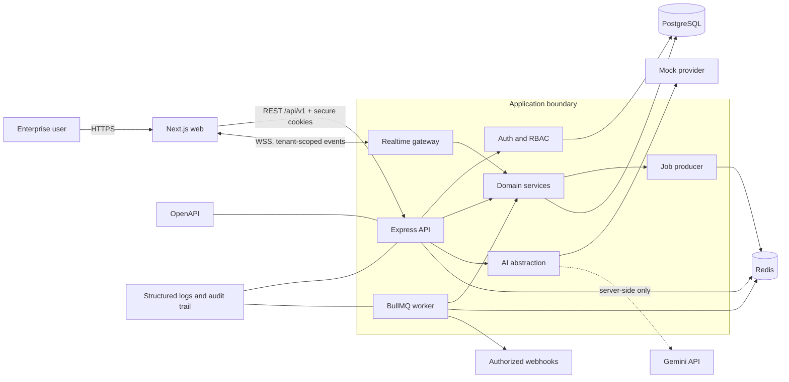

# System Architecture

## Context

NEXORA AI is a multi-tenant modular monolith. The API keeps domain boundaries explicit while avoiding distributed-system overhead before scale requires it. Background jobs and WebSocket delivery run as separate processes from the same API codebase when deployed.



## Request path

1. The web application sends same-site credentials and a CSRF header for mutations.
2. Security middleware validates the origin, CSRF token, access token, session, user status, and organization status.
3. Permission middleware checks the named permission. Repository methods always receive tenant context.
4. The service applies business rules and writes the domain change and audit event.
5. The controller serializes a stable API envelope. Centralized middleware maps errors to safe RFC 7807-style problem details.

## Package boundaries

```text
nexora-ai/
  apps/
    web/       Next.js user interface
    api/       HTTP, WebSocket, jobs, domains, Prisma schema
  packages/
    shared/    cross-runtime schemas and constants
    config/    shared TypeScript and lint configuration
    types/     shared domain/API type declarations
  infrastructure/docker/
  docs/{architecture,database,api,security}/
```

The web app never imports API internals or Prisma types. Cross-runtime inputs and outputs live in `@nexora/shared` as Zod schemas.

## Domain boundaries

- Identity: auth, users, roles, permissions, organizations, sessions.
- Customer: customers, segments, interactions, conversations, transactions, tickets.
- Intelligence: sentiment, churn, lead scoring, recommendations.
- Automation: workflows, executions, webhooks, notifications.
- Insight: analytics, reports, audit logs.
- Platform: integrations, cache, queue, realtime, configuration, observability.

## Security model

- Passwords use Argon2id with configurable memory and iteration cost.
- Short-lived JWT access tokens and rotating refresh tokens are stored only in `HttpOnly`, `Secure` production cookies.
- Refresh-token hashes, not raw tokens, are persisted. Token-family reuse revokes the family.
- Mutating cookie-authenticated requests require a double-submit CSRF token and trusted origin.
- Every tenant-owned table carries `organization_id`; API repositories apply it from authenticated context rather than client input.
- Permissions are deny-by-default. Super Admin cross-tenant operations require a dedicated platform permission and emit audit events.
- Customer PII responses are masked unless the caller has the explicit `customer:pii:read` permission.
- The Gemini key exists only in the API/worker environment.

## Scale path

- Stateless API replicas share PostgreSQL and Redis.
- BullMQ workers scale independently by queue.
- Redis Pub/Sub fans tenant-scoped events to multiple WebSocket nodes.
- Read-heavy analytics use cached aggregate queries first, then materialized views or a warehouse when workload justifies them.
- Domain modules can be extracted later because controllers depend on service interfaces and services depend on repositories.
