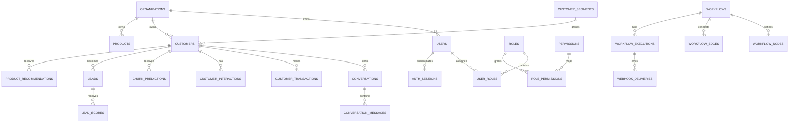

# Database Schema

## Conventions

- PostgreSQL UUID primary keys use `gen_random_uuid()`.
- Tenant-owned rows include required `organization_id` and tenant-first composite indexes.
- Timestamps use UTC `timestamptz` semantics through Prisma `DateTime`.
- Mutable business entities use `created_at`, `updated_at`, and nullable `deleted_at` where recovery is useful.
- Money uses `Decimal(18,2)` plus an ISO currency code.
- Scores use integer 0–100 with application and database constraints where migrations support them.
- Structured explainability data uses JSONB while searchable/filterable dimensions remain relational columns.

## Identity and tenancy

| Table | Purpose | Important constraints/indexes |
|---|---|---|
| `organizations` | Tenant account | unique `slug`; indexed `status` |
| `users` | Tenant user identity | unique normalized `email`; indexed `(organization_id, status)` |
| `roles` | System or tenant role | unique `(organization_id, code)` with nullable organization for system templates |
| `permissions` | Stable permission catalog | unique `code` |
| `user_roles` | User-role assignment | unique `(user_id, role_id)`; tenant consistency enforced in service/transaction |
| `role_permissions` | Role permission grant | unique `(role_id, permission_id)` |
| `auth_sessions` | Refresh rotation and revocation | unique token hash; indexed `(user_id, family_id)`, `expires_at` |

## Customer and interaction

| Table | Purpose | Important constraints/indexes |
|---|---|---|
| `customer_segments` | Tenant-defined segments | unique `(organization_id, name)` |
| `customers` | Customer 360 core | unique `(organization_id, external_id)`; indexes for name, status, risk, segment |
| `products` | Eligible product catalog | unique `(organization_id, sku)` |
| `customer_transactions` | Purchases/payments | indexes `(organization_id, customer_id, transacted_at)` and product |
| `conversations` | Omnichannel threads | unique `(organization_id, external_id)`; channel/status/customer indexes |
| `conversation_messages` | Ordered thread messages | index `(organization_id, conversation_id, sent_at)` |
| `customer_interactions` | Normalized touchpoints | index `(organization_id, customer_id, occurred_at)` |
| `support_tickets` | Complaints and service cases | unique `(organization_id, ticket_number)`; customer/status/priority indexes |

## Intelligence and sales

| Table | Purpose | Important constraints/indexes |
|---|---|---|
| `sentiment_analyses` | Versioned structured analysis | message/conversation indexes; provider and model metadata |
| `churn_predictions` | Versioned deterministic/predictive score | index `(organization_id, risk_level, scored_at)`; factors JSONB |
| `leads` | Pipeline entity | index `(organization_id, stage, owner_id)` |
| `lead_scores` | Versioned lead score result | lead/scored-at index; factors and calibration metadata |
| `product_recommendations` | Eligibility-filtered recommendation | customer/status/relevance indexes |

## Automation and operations

| Table | Purpose | Important constraints/indexes |
|---|---|---|
| `workflows` | Versioned workflow definition | unique `(organization_id, name, version)`; status index |
| `workflow_nodes` | Typed visual/executable nodes | unique `(workflow_id, node_key)`; configuration JSONB |
| `workflow_edges` | Directed node graph | indexes by workflow/source/target |
| `workflow_executions` | Run state and retry metadata | unique optional idempotency key per tenant; status/started-at index |
| `webhook_endpoints` | Encrypted endpoint configuration | organization/status index; no raw secrets in logs |
| `webhook_deliveries` | Attempt history | execution/status/next-attempt indexes |
| `notifications` | In-app operational alerts | recipient/read-at index |
| `integrations` | Channel/provider configuration | unique `(organization_id, provider, name)`; encrypted credentials |
| `report_jobs` | Async export metadata | requester/status index; expiry timestamp |
| `audit_logs` | Append-only security/business trail | tenant/actor/action/resource/time indexes |

## Tenant isolation invariant

Client-supplied `organization_id` is never trusted. Auth middleware derives tenant context from the validated session. Every repository method for a tenant entity requires that context and places `organization_id` in reads, writes, updates, and deletes. Relationship creation re-queries related IDs under the same tenant within a transaction.

PostgreSQL row-level security is a planned defense-in-depth deployment option. The first application version still enforces tenant scope in repositories because background jobs and migrations need explicit, testable behavior independent of connection-local RLS state.

## Relationship overview

